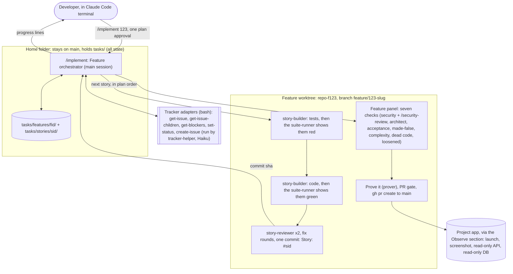
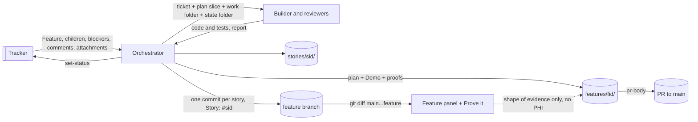

# ARCHITECTURE.md — Feature build in `/implement` ("a Feature is one unit of work")

**Version:** 1.0
**Date:** 2026-10-05
**Author:** Anudeep Sharma
**Status:** Draft. Regulated data is in scope (Prove it reads KBA data) and no compliance owner is named yet; see §6.
**Requirements:** [`grill-summary.md`](grill-summary.md) (14 decisions, 2026-09-30), from [`feature-unit-grill-brief.md`](feature-unit-grill-brief.md)
**Platform:** local only. The harness runs in a Claude Code terminal on the developer's machine. The only outside systems are the trackers and each project's own app. The eight sections are adapted to that: cost means tokens and agent runs, scale means how many Features run side by side, and recovery means resume and crashes.

---

## 1. High-level component diagram



**Folder layout (all siblings, never nested):**

```
claude-code-harness\         home folder, stays on main, holds tasks\ (all state)
claude-code-harness-f123\    Feature worktree, branch feature/123-slug
```

| Component | Owns | Never does |
|---|---|---|
| **Orchestrator** (main session, home folder, Sonnet) | Reads the Feature and its dependency graph. Creates the Feature worktree. Builds the stories one after another in plan order, one commit per story. Runs the Feature panel, Prove it, the closing check (when the Feature completes a coverage table), the PR gate and the PR. Owns the one human stop (the plan gate: plan, coverage, every open question). Writes `tasks/features/<fid>/` and `tasks/stories/<sid>/` and prints progress lines | Edits story code |
| **Feature worktree** | The Feature branch and every story's code, kept out of the home folder so home stays on main ([git-worktrees.md](rules/git-worktrees.md)) | none |
| **`story-builder`, `suite-runner`, `story-reviewer`** | The per-story work: tests then code, the suite run, the two reviews. Each gets a **work folder** (the Feature worktree) and a **state folder** (home `tasks/`) | Stage, commit or push (the orchestrator commits) |
| **`tracker-helper`** (Haiku) | Every tracker read and write, so tickets stay out of the main session | Anything but the tracker adapters |
| **Feature panel** | The whole-branch review on `git diff main...feature/<fid>` | Edits the tree while it reads (Hydra rule: commit first, change nothing during the reviews) |

**How deep agents go:** main → builder, runner or reviewer is 1 layer below the main session, and none of them starts agents of its own.

**One story at a time.** Only the orchestrator writes the Feature branch, so there are no merge races and no merge step. Each story ends in one commit with the trailer `Story: #<sid>`, made only when its scoped tests are green.

**Overlapping stories.** Stories are built in plan order, so an overlap link (same file or module) needs no special handling: the second story starts from a branch that already has the first one's commit. A story that cannot be finished is stuck (§8).

---

## 2. Service / platform selection rationale

| # | Component | Choice | Why this over alternatives |
|---|---|---|---|
| 1 | Story order | **Stories in sequence**, one after another in plan order, in one Feature worktree ([ADR-0005](docs/adr/0005-stories-in-sequence-on-the-feature-branch.md)) | Token cost: a Feature run with parallel stories spent 70 to 90 agents and a 5-hour usage window in about an hour. One at a time also matches the Software Factory's `work-feature`. Rejected: *a worktree per story*, because the fixed cost per story stays and only the rate changes; *parallel stories in one folder*, because build scratch collides and commits get mixed |
| 2 | Worktree creation | **The orchestrator runs `worktree.js feature`** to make the one Feature worktree from the base branch | Keeps the home folder on main. Rejected: *the agent's built-in `isolation: "worktree"`*, which only starts from the default branch or HEAD (Claude Code docs, worktrees) |
| 3 | Story workers | **Named agents `story-builder`, `suite-runner`, `story-reviewer`** (and `tracker-helper` for the tracker), each with a fixed job and no Agent tool | A named agent is a quality contract ([autonomous-mode.md](rules/autonomous-mode.md)), so a `general-purpose` stand-in isn't allowed. The main session keeps the plan, the judgement and the commits, and never holds the code. Rejected: *a runner per story that starts its own agents*, which is the 70-to-90-agent shape |
| 4 | Paths | **Every agent gets a work folder (the worktree) and a state folder (home `tasks/`)**, replacing the single `YOUR_PROJECT_ROOT` | Fixes the single-root rule the build agents carried ("may NOT access files outside `YOUR_PROJECT_ROOT`") and the mix of anchored and bare `tasks/` paths in [implement/SKILL.md](skills/implement/SKILL.md) and the retired `run-tasks` skill. **This is the riskiest edit in the work**: these agents run on every build, standalone ones included |
| 5 | Story → Feature branch | **One commit per story, trailer `Story: #<sid>`, made only on a green scoped run** | The Feature branch only ever holds stories that passed, and resume reads the trailers. Rejected: *squash*, because it loses the per-story history; *a merge per story*, because it needs a branch and a worktree per story |
| 6 | Verify lock | **The default takes no lock**: one story builds at a time in each working folder, so nothing queues (the per-story lock and the executor waves that held it are gone, F73 #83). Setting `verify-lock: global` in lessons/notes, for stacks whose Features share a port, database or global cache, uses `<state>/.verify.lock`, through `test-lock.js`: the one lock for all sessions, in front of each build, test and E2E command of the builder, suite runner, prover, evaluator, acceptance agent and `/local-test` (never a long-running start command) | Only one story builds at a time, so inside a Feature or a standalone run there is nothing to queue. Under `global`, the lock serialises the test commands of runs built side by side. Rejected: *today's one lock per repo*, which queues every Feature behind every other |
| 7 | State format | **Plain `key: value` markdown files, plus single-line progress lines** | Same format as `executor-state.md` and `phase.md` today. Rejected: *JSON*, which would be inconsistent with every existing state file |
| 8 | Tracker access | **Bash adapters, plus the new `set-status.sh` in all four** (ADO, GitHub, Todoist, local) | Existing pattern, works on every tracker |
| 9 | Built-in `/security-review` | **Run from the security reviewer agent, working inside the Feature worktree** | It reviews "the current branch", and the main session's folder is home, on main. **Proven (F6 spike, 2026-10-06, Claude Code 2.1.289):** a subagent cannot type a slash command, so it runs `claude -p "/security-review"` as its own headless session with the Feature worktree as the current folder; that reviewed the worktree's branch against `origin/HEAD` and reported the vulnerability planted there. It needs `claude` on the PATH and an `origin/HEAD`. When either is missing, the agent runs the same checklist on `git diff main...feature/<fid>` and reports the built-in as unavailable, never quietly skipped |
| 10 | One story loop | **A standalone story is built by the same story loop as a Feature's** (`story-builder`, `suite-runner`, `story-reviewer`); the executor, the waves, the plan-lint hook and `/troubleshoot` are retired (F73 #83) | One way to build a story means one set of rules to keep true; the wave machinery only ever served the standalone path and cost more agents for the same result. A failed e2e gate goes to `/debug` and the prover's `diagnose` job. Rejected: *keeping the executor for standalone runs*, which keeps two builders and two sets of lock and restore rules |

**Cloud platform:** none (local only).

---

## 3. Cost-at-scale estimates

The cost is **tokens and agent runs**, not money. The numbers are **measured from the run report once a Demo has run** (§7): every agent result returns its tokens, tool calls and duration, and the report adds them up per story and per Feature. The old parallel design is the reason for the change: one Feature run spent 70 to 90 agents and a 5-hour usage window in about an hour ([ADR-0005](docs/adr/0005-stories-in-sequence-on-the-feature-branch.md)). Nothing here is a guess to plan around until a Demo's report fills it in.

### Shape of one story

| Part | Agent runs | Model |
|---|---|---|
| Tests: `story-builder` (job tests), then `suite-runner` to show them red | 2 | Sonnet |
| Code: `story-builder` (job code), then `suite-runner` to show them green | 2 | Sonnet |
| Review round 1: two `story-reviewer` calls (correctness, rules and quality) | 2 | Sonnet |
| **About 6 agents per story**, plus fix rounds | | |
| Fix rounds: a `story-builder` fix, a re-review and a green run each | 3 per round | Sonnet in rounds 1 to 3; in rounds 4 and 5 only the fix builder and the re-review run on Opus, the green `suite-runner` stays Sonnet |

### Per Feature

| Part | Models |
|---|---|
| Understand and plan (one plan gate) | Opus |
| The seven-check panel on the whole branch | Opus for security, architecture, acceptance and made-false; Sonnet for complexity, dead code and loosened |
| Prove it (`prover`) | Sonnet; Opus to diagnose a failed criterion |
| The closing coverage audit | Opus |
| Orchestrator and tracker moves | Sonnet and Haiku |

### Burst scenario

| Trigger | Impact | Mitigation |
|---|---|---|
| A story hits the 3-attempt rule, or goes to review rounds 4 and 5 | more agents for that story, and Opus for the late rounds | the 3-attempt rule caps retries; at most 5 review rounds; a stuck story is held, not retried forever |
| A long Feature | the usage window is reached partway | `run-paused reason="usage limit"` and resume (§8); only one story runs at a time, so the rate stays low |

One Feature with one story costs about the same as a standalone item.

---

## 4. Data architecture

### Storage

Everything is in the home folder's `tasks/` (gitignored), reached by absolute path, **never inside a worktree**.

| Location | Writer | What lives here | Retention |
|---|---|---|---|
| `tasks/features/<fid>/feature-state.md` | orchestrator only | run mode, plan approved yes/no, Feature branch and worktree, current phase. Per story: status (`pending` / `running` / `committed` / `stuck` / `held` / `skipped`), base ref, commit sha, attempts. Saved after every step. Resume checks it against the `Story:` commits on the Feature branch, which win if they disagree | kept |
| `tasks/features/<fid>/plan.md` | orchestrator | story order, Demo, proof and observation per criterion | kept |
| `tasks/features/<fid>/phase.md` | orchestrator | Feature-level marker | kept |
| `tasks/features/<fid>/progress.log` | orchestrator | progress lines, appended (§7) | kept |
| `tasks/features/<fid>/review/*.md`, `prove-it.md`, `pr-body.md`, `decisions-log.md` | orchestrator | panel reports, proof results, PR body, and the one decisions log, each line starting `#<sid>:` | kept |
| `tasks/stories/<sid>/` | orchestrator (`ticket.md`: `tracker-helper`) | `ticket.md`, `executor-state.md` (+ `feature: <fid>`, the red evidence and the review round), `phase.md`, `.tree-baseline`, `stuck.diff` when a story is stuck. In a Feature the story's plan is its `## Story #<sid>` section of the Feature `plan.md`, so there is no per-story plan or test-strategy; a standalone run writes `plan.md` and `brief.md` there (the brief holds the story's Goal) | kept |

**One commit per story**, with the trailer `Story: #<sid>`, on the Feature branch. The Feature worktree is the only place story code lives.

**One writer per file** is true per Feature, so nothing inside one Feature needs locking: only one story runs at a time, and the orchestrator writes every state file, except `ticket.md`, which `tracker-helper` writes. Across sessions some things are shared, and each is handled: `lessons.md`/`notes.md` and the sprint file are read just before they are edited and re-read after a failed Edit; the shared `.git` is written through `worktree.js`, which retries a lock file another session holds and never deletes one; the test commands queue on one lock under `verify-lock: global`; and the home folder stays on main (a standalone run asks first when a Feature session is open). The builders and reviewers write product code and tests, and report back. A Feature run keeps one decisions log, with each line prefixed by its story ([autonomous-mode.md](rules/autonomous-mode.md)).

**`phase.md`** gets two optional keys, `feature:` and `story:`. The contract already says unknown keys are ignored, so `schemaVersion` stays 1.

### Data flow



### Regulated data paths

Prove it reads the real system through the read-only APIs and database, which on KBA projects can hold **PHI and PII**.

1. **The Observe section declares an environment**, local or test only. Prod is refused unless the project's rules explicitly allow it.
2. **Prove it records the shape of evidence only**: row counts, ids, field names, status codes, pass/fail. Never raw row contents or response bodies.
3. **Screenshots stay local** in `tasks/features/<fid>/review/`. The PR says what was seen and where the screenshot is, and never attaches it.
4. The security reviewer's "no sensitive data in logs" check covers `progress.log`, `prove-it.md` and `pr-body.md`, and `bin/pr-gate.js` refuses a PR while either of the last two holds a raw value (it names the line and the kind, never the value).

### Partitioning

Not applicable. There are no databases; state is per Feature and per story folder.

---

## 5. Scalability model

### More work at once

**Stories never overlap: parallel only across Features** (story #73). Inside a Feature there is one story in flight, so there is no width setting and no agent limit to manage. Building two Features side by side is built (story #82, [ADR-0006](docs/adr/0006-one-session-per-feature.md)): one session per Feature, each opened in the home folder and building in its own Feature worktree. A second session on the same Feature is refused by the claim (`feature-state.js claim`); under `verify-lock: global` the test commands queue on `test-lock.js`; the disk check counts what other Features will still create (`disk-check.js --feature`). A standalone run that starts while a Feature session is open (a fresh `claim.md`) asks first, before it checks out a branch in the shared home folder (Risk 4). The table below is what to expect, not something measured.

| | One Feature | Two Features side by side |
|---|---|---|
| Agents at once | the story's builder or reviewers, a handful | twice that |
| Disk (a worktree with dependencies, about 1–3 GB) | 1 extra | 2 extra |
| Machine load | fine | builds and tests run side by side: tests can time out from load, not code ([tasks/notes.md](tasks/notes.md)) |
| Usage window | low rate | about twice the rate |

- The Feature panel runs only after every story is committed, so it never overlaps with the stories.

**Bottleneck order:** the usage window, then machine load when Features run side by side.

### Bigger Features

| | 5 stories | 15 stories | 40 stories |
|---|---|---|---|
| Orchestrator context | fine | compacts, recovered from `feature-state.md` | resume becomes the normal path |
| Feature panel diff | fine | large | **too big to review properly** |
| Plan approval | one screen | long | rubber stamp |

**Limit: 8 stories per Feature, each 1, 2 or 3 points (5 only with a written reason).** `/plan-features` splits anything bigger into two Features, each with its own Demo, so a Feature fits in one sprint. `/implement` warns at plan approval but doesn't refuse.

---

## 6. Security architecture

Claude Code behaviour this section relies on (Claude Code docs, sub-agents and hooks):
- **Background agents' permission prompts pop up in the main session**, so an unapproved command stops the whole run.
- **`PreToolUse`/`PostToolUse` hooks run for every agent's tool calls**, so the existing `safety-check.js` protects builders, test runners and reviewers.
- **Agents can't raise their own permissions.**

### What agents are allowed to run

| Layer | Mechanism | Details |
|---|---|---|
| Allowed commands | **A narrow allowlist, set up before the run** | `git worktree add/remove` (the Feature worktree), `git commit` by path, the build and test commands from lessons/notes, `trackers/active/*.sh`, `gh pr create`, the Observe commands. **Never a blanket "allow all Bash"** |
| Startup check | Plan commands compared with the allowlist | anything missing is listed **before** the run starts, so you approve once at the start |
| Always blocked (`safety-check.js`) | Hook on every agent's tool call | force-push, forced worktree removal, force-deleting a branch, hard resets, and any push to main. The only push is the Feature branch |

### Data classification

| Classification | Examples | Where it may go | Access control |
|---|---|---|---|
| Regulated (PHI/PII) | rows and responses read by Prove it on KBA projects | only in the moment; only its shape is recorded (§4) | read-only credential, test environment only |
| Internal | code, plans, reviews, decisions log | `tasks/` (local, gitignored), PR body | developer |
| Secret | credentials | environment variables or the OS secret store only | developer |

### Secret handling

| Secret | Storage | Rule |
|---|---|---|
| Tracker (`az login`, `gh auth`, Todoist token) | the tool's own login | existing `auth-check.sh`; expired means stop at startup |
| Read-only API / DB for Observe | environment variables or the OS secret store | the Observe section names the variable, never the value. "Read-only" is enforced by the credential (a read-only database user), never just by an instruction to the agent |
| Any credential | never in `tasks/` files, `progress.log`, the PR body or an agent prompt | the security reviewer checks those files |

**Compliance Owner sign-off** (required, because Prove it touches PHI/PII on KBA projects). There is no `tasks/compliance-owners.md` in this project (solo pack); create one from `templates/tasks/compliance-owners.md`. This document stays **Draft** until both are signed:
- Privacy Officer: (unassigned) Date: (pending)
- Security Lead: (unassigned) Date: (pending)

---

## 7. Observability plan

### Progress lines

A fixed single line, printed in the terminal and appended to `tasks/features/<fid>/progress.log`:

```
[harness] ts=2026-10-05T14:02:11Z feature=123 story=201 event=story-started phase=coding
```

| Event | When |
|---|---|
| `run-started` / `run-paused` / `run-finished` | start, any stop, end |
| `phase` | every Feature-level phase change: planning, coding, reviewing, proving, shipping |
| `story-started` / `story-committed` / `story-stuck` | each story's lifecycle |
| `review-done` | each panel reviewer, with its finding count |
| `proof` | each criterion: met / not met / needs-person |
| `pr-opened` | with the PR number |

The same safety rules as `phase.md` `detail` ([phase-markers.md](rules/phase-markers.md)): one line, no control characters, a 200-character limit, no PHI or secrets.

### Markers and hang detection

- `phase.md` per Feature and per story, overwritten each step, shows the current state.
- **Hung story:** agents run in the foreground, so a live session cannot see one that has hung (the call never returns), and checking between calls would only misfire on slow agents. A hang ends with the person stopping the session; it is caught on `--resume`, by running `feature-state.js hung` on the running story's `phase.md`. Not updated in **30 minutes** (the existing freshness rule) means one relaunch of that step; the same step stopping a second time (a new step starts the count again) means the run pauses and asks you whether to retry it or mark the story stuck. It never marks a story stuck by itself: on a resume nothing is running, so an old `phase.md` only says the session stopped (a crash, a closed laptop, the usage limit).

### Run report

Written at the end and included in the PR:
- per story: time taken, attempts, findings;
- **measured agent count and tokens**. Every agent result already returns its tokens, tool calls and duration, so the orchestrator adds up the totals of every builder, runner, reviewer and panel agent it started. This fills in §3;
- decisions made on your behalf, and anything that needs a person.

### Alerts

There's no dashboard. An alert is the run stopping and saying why: a stuck or hung story, three failed attempts, a missing tool or permission at startup, the usage limit, a red suite that will not go green.

### Tracing

Not applicable beyond the progress lines. Each line carries `feature=` and `story=`, which is enough to follow one story through a run.

---

## 8. Disaster recovery

| Metric | Target | Current | Gap |
|---|---|---|---|
| **Point lost (RPO)** | at most the step in flight; state saved after every step | met (F1): a step record after every step, re-read first after a compaction | none |
| **Time to recover (RTO)** | minutes: `/implement --resume <fid>`, committed stories never redone | met (F1, F4, F72): `--resume` for a story and for a Feature; `/run-tasks` retired (F7) | none |

### Failure scenarios and recovery

| Scenario | Detection | Recovery | Tested? |
|---|---|---|---|
| Main session compacts | the conversation starts with a summary | re-read `feature-state.md` before anything else, print the current phase again, carry on | yes: `feature-mode.probe.test.js`, and lived through in every Feature's build |
| Terminal closed, laptop asleep, session crash (background agents stop with it) | the developer runs `/implement --resume <fid>` | a resume: the `Story:` commits on the Feature branch are read first, and a story with its commit is skipped. The story in flight carries on from its saved `executor-state.md` step (tests, code, review round) | yes: `feature-state.test.js` (resume) |
| A builder or reviewer crashes or hangs | an error result, or a hang (no progress for 30 minutes) caught on `--resume`, after the person stopped the session mid-step | the story's uncommitted edits are kept; one relaunch of that step from the saved step; the same step stopping a second time means the run asks you (retry, or mark it stuck) | yes: `feature-state.test.js` (hung, stuck) |
| A story cannot go green or clean | the 3-attempt rule, or round 5 of review is still open | `/debug`, then stop and ask; the story is stuck and nothing is committed for it | yes: `feature-state.test.js` (stuck) |
| Usage limit reached | agents return limit errors | `run-paused reason="usage limit"`, resume once the limit resets | no |
| Tracker unreachable | an adapter error | at startup: stop. During the run: log it and carry on | partly: a failed status write is a `tracker-error` line (F2) |
| Not enough disk | startup check: free space vs. the Feature worktree's estimated size | stop at startup with the number needed | yes: `disk-check.test.js` |
| Branch moves in the Feature worktree | branch check before every story | stop; never decided automatically | yes: `worktree.test.js` (check-branch) |

**Stuck-story rule (from the grill, Q11):** a stuck story and its dependents are held at `needs-person`. Stories that do not depend on it are still built, in plan order. The run pauses before the Feature-level phases, and there is no PR while a story is stuck.

The two probes that remain (resume after compaction, resume after a crash) were built in F4; the table
above names where each lives. The other two this section once asked for, a merge conflict and a failing
test after a merge, were retired with the merge step ([ADR-0003](docs/adr/0003-orchestrator-only-merger.md)).

---

## Appendix: Decision log

| Decision | Rationale | ADR |
|---|---|---|
| One build skill: `/implement` builds Features; `/story` retired | one build engine; keeps test-first, autonomous, rework and their probes | [ADR-0001](docs/adr/0001-one-build-skill.md) |
| Stories in sequence on the Feature branch, one commit per story (supersedes ADR-0002 and ADR-0003) | token cost (70 to 90 agents in a 5-hour window) and parity with the Software Factory | [ADR-0005](docs/adr/0005-stories-in-sequence-on-the-feature-branch.md) |
| One session per Feature, all opened in the home folder (refines ADR-0004 and the one-terminal rule) | two Features at once, as the factory's `work-feature` runs | [ADR-0006](docs/adr/0006-one-session-per-feature.md) |
| Story worktrees, and merge-tested by the orchestrator (superseded) | parallel stories without shared files; kept for the record | [ADR-0002](docs/adr/0002-story-worktrees.md), [ADR-0003](docs/adr/0003-orchestrator-only-merger.md) |
| Work folder and state folder split for every agent | the only way agents can work in a worktree; changes the prompts every build uses | [ADR-0004](docs/adr/0004-work-folder-state-folder.md) |
| One writer per state file; one decisions log per Feature, lines prefixed `#<sid>:` | one story at a time, so no locking and no lost lines | in this document |
| Verify lock per working folder, with a global setting | builds that share a port or cache queue | in this document |
| Soft limit of 8 stories per Feature | reviewer depth is the real limit | in this document |
| Prove it records the shape of evidence only; Observe test environment only | PHI/PII on KBA projects | in this document |
| Allowlist checked before the run instead of auto or bypass-permissions mode | background-agent prompts would stall the run; runs read PHI | in this document |

## Appendix: Known issues found while writing this

- ~~**`safety-check.js` checks the text of every file written, not just commands.**~~ Fixed in #23: the destructive-command rules apply to Bash only, and the installed global copy now matches the repo. A Write is still checked for hardcoded secrets.
- **`drift-check.js` reads Mermaid diagram labels as component names** and reports them as drift against `todo.md`. Harmless, but noisy on every architecture edit.

## Appendix: What building it taught us

Each Feature (F1–F7) was built and then demoed on a throwaway project with real agents. What those
runs showed that the design did not foresee, and what changed because of it:

- **A subagent cannot wait for agents it starts in the background.** A story runner started its
  reviewers with `run_in_background`, ended its turn "waiting", and reported nothing; their results
  went to the main session. Runners started every agent in the foreground, several in one message
  when they should run side by side (F5). The runners are gone (F72); the rule carries over to the main
  session, which waits for each agent it starts.
- **Paths relative to the current folder break inside a worktree.** `observe-check.js`'s default path
  pointed at a `tasks/` only the home folder has; runners passed the state folder's file explicitly (F5).
  The main session does the same.
- **The built-in `/security-review` can review a Feature branch** when run as `claude -p` from the
  Feature worktree (§2 #9, F6). A subagent cannot type a slash command, so this is the only way in.
- **Agent definitions load when a session starts.** An agent added mid-session is "not found" until a
  restart, and a startup check that only looks for the file cannot see that. It only bites while the
  harness itself is being changed; an install is always followed by a new session (F6).
- **Removal must go through git.** The safety hook blocks recursive deletes, so Prove it's scratch
  copy is a detached `git worktree`, removed by `git worktree remove` only once clean — which doubles
  as the check that every broken line was put back (F6).
- **Nothing was lost retiring `/story` and `/run-tasks`** — but three small things had drifted into
  `/story` only (reading `lessons.md`, the default-branch push guard, the no-PII line for the decisions
  log). The inventory caught them; they now apply in both packs (F7,
  [docs/story-retirement-inventory.md](docs/story-retirement-inventory.md)).
- **Parallel stories cost too much** (F72). A Feature run with a runner per story spent 70 to 90 agents
  and a 5-hour usage window in about an hour. Stories are now built one after another on the Feature
  branch, by a handful of named agents with fixed jobs and a model per job
  ([ADR-0005](docs/adr/0005-stories-in-sequence-on-the-feature-branch.md)).
